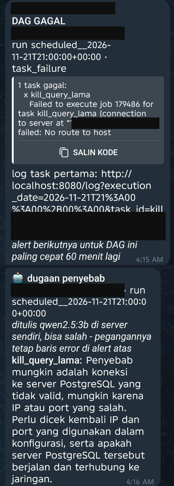

# airflow-llm-alerting

[](https://github.com/Superaordaaa/airflow-llm-alerting/actions/workflows/tests.yml)

When an Airflow task fails or runs slow, you get the raw alert on **Telegram** right away. A moment later, a **local LLM (Ollama, Qwen 2.5)** follows up with a short plain-language explanation of the likely cause and what to check first.

This is a clean demo of a pattern I run in production as a Data Engineer, rewritten from scratch with no company code or configuration.

## In production


*A real alert from production. The messages are in Indonesian, and internal names, the IP address, and the port are redacted.* The first message is the raw failure with the log link and a cooldown note. The second, from `qwen2.5:3b` on our own server, explains that the PostgreSQL connection failed, probably because of a wrong IP/port or an unreachable server, and says what to check. It's clearly labelled as model output that can be wrong.

## How it works
```
Airflow task fails / runs slow
        │  on_failure_callback / on_success_callback
        ▼
same DAG alerted in the last 60 min? ── yes ──► stay quiet (cooldown)
        │ no
        ▼
① Telegram: raw alert  (DAG · task · run · error tail · log link)   ← never waits on the LLM
        │
        ▼
Ollama (local, free) ── unavailable? ──► done, the raw alert is already out
        │
        ▼
② Telegram: 🤖 likely cause + what to check first  ("can be wrong" label)
```

## Why
- **Raw tracebacks are slow to read**, especially at night or on a phone.
- **The raw alert goes out first**, so a slow or crashed LLM can never delay or swallow an alert.
- **A local model** keeps error data on your own server and costs nothing per call.
- **Per-DAG cooldown** stops a flapping DAG from flooding the chat.
- **The explanation is labelled as model output.** The error line stays the source of truth.

## Setup
1. Install and start [Ollama](https://ollama.com), then pull a model:
   ```bash
   ollama pull qwen2.5        # or qwen2.5:3b on a small server
   ```
2. Create a Telegram bot with @BotFather and get your chat ID.
3. Copy `alerting/` into your Airflow `dags/` folder (or onto `PYTHONPATH`), install `requests`, and set the variables from `.env.example`.
4. Attach the callbacks:
   ```python
   from alerting import on_failure, on_success_check_slow

   default_args = {
       "on_failure_callback": on_failure,
       "on_success_callback": on_success_check_slow,  # alerts if duration > SLOW_TASK_SECONDS
   }
   ```
5. Trigger `dags/example_alerting_dag.py`. Its task fails on purpose, so you can see both messages arrive.

## Configuration
| Variable | Default | Purpose |
|---|---|---|
| `OLLAMA_URL` | `http://localhost:11434` | Ollama server |
| `OLLAMA_MODEL` | `qwen2.5` | Any model you have pulled |
| `TELEGRAM_BOT_TOKEN` | — | Bot token |
| `TELEGRAM_CHAT_ID` | — | Chat or group to alert |
| `SLOW_TASK_SECONDS` | `1800` | Threshold for the slow-task alert |
| `ALERT_COOLDOWN_MINUTES` | `60` | Quiet period per DAG and event; `0` disables it |
| `ALERT_STATE_FILE` | `<temp>/airflow_llm_alert_state.json` | Where the cooldown timestamps are stored |

## Tests
These tests need no Airflow, Ollama, or Telegram, because the HTTP calls are mocked:
```bash
python -m unittest discover -s tests -v
```

## Notes
- The cooldown state is a small JSON file. With several Airflow workers on different machines, point `ALERT_STATE_FILE` at shared storage, or swap in Redis or a database table.
- Errors are trimmed before being sent to the model and to Telegram, so messages stay short.

## License
MIT
